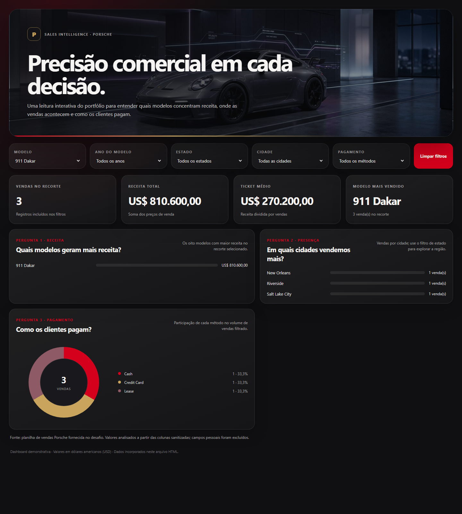

# Porsche Sales Intelligence

Dashboard interativa de vendas Porsche em um único arquivo HTML, preparada para GitHub Pages. A [dashboard](./index.html) reúne os dados sanitizados e a foto de fundo no próprio arquivo: não depende de bibliotecas ou serviços externos.

## Perguntas de negócio

1. **Quais modelos geram mais receita?** O ranking por faturamento ajuda a identificar onde a receita está concentrada, além de comparar somente o número de unidades.
2. **Em quais cidades vendemos mais?** O volume por cidade ajuda a explorar a distribuição geográfica; os filtros de estado e cidade permitem analisar cada região.
3. **Como os clientes pagam?** A participação dos métodos de pagamento ajuda a entender a composição das vendas por modalidade.

Os indicadores no topo mostram quantidade de vendas, receita, ticket médio e modelo mais vendido por unidades. Os filtros de modelo, ano do modelo, estado, cidade e pagamento atualizam todos os indicadores e gráficos.

## Dados e tratamento

- A fonte foi a planilha sanitizada fornecida com o desafio. Ela foi usada localmente para montar os dados da dashboard, mas não foi incluída no repositório, pois contém campos pessoais que não são necessários à análise.
- Foram utilizados somente os campos sanitizados de modelo, ano do modelo, preço, método de pagamento, cidade e estado. Nomes de clientes e vendedores, datas e quilometragem não foram incorporados ao HTML.
- Os preços sanitizados foram convertidos para números decimais, e os anos do modelo para números inteiros; os anos são usados como filtro categórico na interface.
- Os 100 registros possuem os seis campos selecionados preenchidos. A receita total é **US$ 12.827.800,50** e o ticket médio é **US$ 128.278,01**.
- O repositório contém a dashboard, este README e a captura de evidência em `evidencias/`. A planilha de origem e os arquivos de exemplo não foram enviados.

## Perguntas e especificação usada

**Síntese da especificação que orientou a implementação**

> Crie uma dashboard executiva de vendas Porsche em um único arquivo HTML, em português, usando somente as colunas sanitizadas da planilha. Responda a três perguntas: quais modelos geram mais receita, em quais cidades há mais vendas e como os clientes pagam. Inclua filtros para modelo, ano do modelo, estado, cidade e método de pagamento; indicadores para quantidade de vendas, receita, ticket médio e modelo líder; e gráficos atualizados por todos os filtros. Use um visual escuro e sofisticado, com vermelho e dourado, responsivo para celular e sem dependências externas. Não inclua nomes de clientes ou vendedores.

O escopo foi refinado para combinar perguntas complementares de receita, distribuição geográfica e pagamento. O ranking de modelos passou a destacar receita, além do volume de vendas; os filtros foram aplicados a todos os indicadores e gráficos; e a imagem ilustrativa foi incorporada ao HTML para manter o arquivo autônomo.

## Publicação

- **Repositório público:** https://github.com/JeanClaude-Dev/dashboard_porsche_sales
- **Dashboard publicada:** https://jeanclaude-dev.github.io/dashboard_porsche_sales/

## Evidência de funcionamento

Exemplo aplicado: filtro de modelo **911 Dakar**. O recorte apresenta **3 vendas**, **US$ 810.600,00** de receita e **US$ 270.200,00** de ticket médio. As três vendas aparecem em New Orleans, Riverside e Salt Lake City.

Captura feita na dashboard publicada. Use “Limpar filtros” para voltar às 100 vendas.
